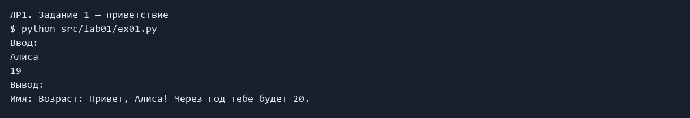

# ЛР1 — Ввод, вывод и форматирование

## Задание и решение

Пять отдельных программ с input и print на приветствие, вычисление суммы и среднего, вычисление по формулам, нахождение целого и остатка.

## Запуск

Все команды выполняются из корня папки `python_labs`, после установки `requirements.txt`.

### Задание 1 — приветствие

```powershell
python ../../src/lab01/01_greeting.py
```

Ввод:

```text
Алиса
19
```

Фактический вывод:

```text
Имя: Возраст: Привет, Алиса! Через год тебе будет 20.
```



### Задание 2 — сумма и среднее

```powershell
python src/lab01/ex02.py
```

Ввод:

```text
3,5
4.25
```

Фактический вывод:

```text
a: b: sum=7.75; avg=3.88
```


### Задание 3 — скидка и НДС

```powershell
python src/lab01/ex03.py
```

Ввод:

```text
1000
10
20
```

Фактический вывод:

```text
price: discount: vat: База после скидки: 900.00 ₽
НДС:               180.00 ₽
Итого к оплате:    1080.00 ₽
```


### Задание 4 — минуты

```powershell
python src/lab01/ex04.py
```

Ввод:

```text
135
```

Фактический вывод:

```text
Минуты: 2:15
```


### Задание 5 — ФИО

```powershell
python src/lab01/ex05.py
```

Ввод:

```text
  Иванов   Иван   Иванович
```

Фактический вывод:

```text
ФИО: Инициалы: ИИИ.
Длина (символов): 20
```


## Код

### src/lab01/ex01.py

```python
name = input("Имя: ")
age = int(input("Возраст: "))
print(f"Привет, {name}! Через год тебе будет {age + 1}.")

```

### src/lab01/ex02.py

```python
a = float(input("a: ").replace(",", "."))
b = float(input("b: ").replace(",", "."))
print(f"sum={a + b:.2f}; avg={(a + b) / 2:.2f}")

```

### src/lab01/ex03.py

```python
price = float(input("price: ").replace(",", "."))
discount = float(input("discount: ").replace(",", "."))
vat = float(input("vat: ").replace(",", "."))
base = price * (1 - discount / 100)
vat_amount = base * vat / 100
print(f"База после скидки: {base:.2f} ₽")
print(f"НДС:               {vat_amount:.2f} ₽")
print(f"Итого к оплате:    {base + vat_amount:.2f} ₽")

```

### src/lab01/ex04.py

```python
m = int(input("Минуты: "))
print(f"{m // 60}:{m % 60:02d}")

```

### src/lab01/ex05.py

```python
parts = input("ФИО: ").split()
fio = " ".join(parts)
initials = ""
for part in parts:
    initials += part[0].upper()
print(f"Инициалы: {initials}.")
print(f"Длина (символов): {len(fio)}")

```

## Вывод

