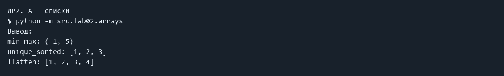
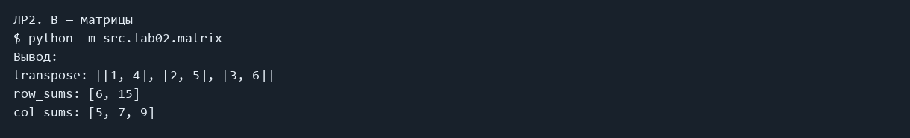
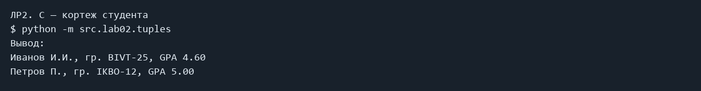

# ЛР2 — Коллекции и матрицы

Работа со списками, кортежами и вложенными списками (матрицами) без готовых min, max и sorted.

### A — списки

```powershell
python -m src.lab02.arrays
```

Фактический вывод:

```text
min_max: (-1, 5)
unique_sorted: [1, 2, 3]
flatten: [1, 2, 3, 4]
```



### B — матрицы

```powershell
python -m src.lab02.matrix
```

Фактический вывод:

```text
transpose: [[1, 4], [2, 5], [3, 6]]
row_sums: [6, 15]
col_sums: [5, 7, 9]
```



### C — кортеж студента

```powershell
python -m src.lab02.tuples
```

Фактический вывод:

```text
Иванов И.И., гр. BIVT-25, GPA 4.60
Петров П., гр. IKBO-12, GPA 5.00
```



## Код

### src/lab02/arrays.py

```python
def min_max(nums: list[float | int]) -> tuple:
    """Находит минимум и максимум циклом. Пустой список — ValueError."""
    if not nums:
        raise ValueError("Список пуст")
    smallest = largest = nums[0]
    for number in nums:
        if number < smallest:
            smallest = number
        if number > largest:
            largest = number
    return smallest, largest


def unique_sorted(nums: list[float | int]) -> list:
    """Убирает повторы и сортирует пузырьком без sorted и sort."""
    result = []
    for number in nums:
        if number not in result:
            result.append(number)
    for i in range(len(result)):
        for j in range(len(result) - 1 - i):
            if result[j] > result[j + 1]:
                result[j], result[j + 1] = result[j + 1], result[j]
    return result


def flatten(mat: list[list | tuple]) -> list:
    """Объединяет строки списков и кортежей; иначе TypeError."""
    result = []
    for row in mat:
        if not isinstance(row, (list, tuple)):
            raise TypeError("Строка должна быть списком или кортежем")
        for item in row:
            result.append(item)
    return result


if __name__ == "__main__":
    print("min_max:", min_max([3, -1, 5, 5, 0]))
    print("unique_sorted:", unique_sorted([3, 1, 2, 1, 3]))
    print("flatten:", flatten([[1, 2], (3, 4)]))

```

### src/lab02/matrix.py

```python
def check_matrix(mat: list[list]) -> None:
    """Проверяет одинаковую длину строк."""
    if mat:
        for row in mat:
            if len(row) != len(mat[0]):
                raise ValueError("У матрицы строки разной длины")


def transpose(mat: list[list[float | int]]) -> list[list]:
    """Меняет строки и столбцы местами."""
    check_matrix(mat)
    result = []
    if not mat:
        return result
    for j in range(len(mat[0])):
        row = []
        for i in range(len(mat)):
            row.append(mat[i][j])
        result.append(row)
    return result


def row_sums(mat: list[list[float | int]]) -> list[float]:
    """Возвращает суммы строк прямоугольной матрицы."""
    check_matrix(mat)
    result = []
    for row in mat:
        result.append(sum(row))
    return result


def col_sums(mat: list[list[float | int]]) -> list[float]:
    """Возвращает суммы столбцов прямоугольной матрицы."""
    return row_sums(transpose(mat))


if __name__ == "__main__":
    matrix = [[1, 2, 3], [4, 5, 6]]
    print("transpose:", transpose(matrix))
    print("row_sums:", row_sums(matrix))
    print("col_sums:", col_sums(matrix))

```

### src/lab02/tuples.py

```python
def format_record(rec: tuple[str, str, float]) -> str:
    """Форматирует студента. Неверные значения — ValueError/TypeError."""
    fio, group, gpa = rec
    if not isinstance(fio, str) or not isinstance(group, str):
        raise TypeError("ФИО и группа должны быть строками")
    if isinstance(gpa, bool) or not isinstance(gpa, (int, float)):
        raise TypeError("GPA должен быть числом")
    parts = fio.split()
    if len(parts) not in (2, 3) or not group.strip() or not 0 <= gpa <= 5:
        raise ValueError("Неверное ФИО, группа или GPA")
    initials = ""
    for name in parts[1:]:
        initials += name[0].upper() + "."
    return f"{parts[0].capitalize()} {initials}, гр. {group.strip()}, GPA {gpa:.2f}"


if __name__ == "__main__":
    print(format_record(("Иванов Иван Иванович", "BIVT-25", 4.6)))
    print(format_record(("Петров Пётр", "IKBO-12", 5.0)))

```

## Вывод

Обязательные задания выполнены. Задания со звёздочками пропущены. Изображения выше сформированы из сохранённого фактического stdout/stderr; это не снимки окна терминала.
