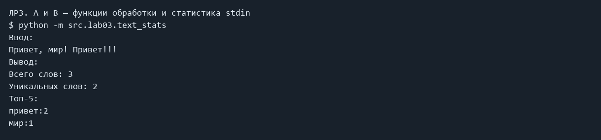

# ЛР3 — Тексты и частоты слов

Нормализация текста, разбитие на слова, счёт частоты и вывод топ-N. Подготовка модуля lib/text.py.

### A и B — функции обработки и статистика stdin

```powershell
python -m src.lab03.text_stats
```

Ввод:

```text
Привет, мир! Привет!!!
```

Фактический вывод:

```text
Всего слов: 3
Уникальных слов: 2
Топ-5:
привет:2
мир:1
```



## Код

### src/lib/text.py

```python
import re
import unicodedata


def normalize(text: str, *, casefold: bool = True, yo2e: bool = True) -> str:
    """Приводит регистр, заменяет ё и схлопывает пробелы."""
    if casefold:
        text = text.casefold()
    else:
        text = text.lower()
    if yo2e:
        text = text.replace("ё", "е").replace("Ё", "Е")
    result = ""
    for symbol in text:
        if unicodedata.category(symbol).startswith("C"):
            result += " "
        else:
            result += symbol
    return " ".join(result.split())


def tokenize(text: str) -> list[str]:
    """Выделяет слова, включая числа и внутренние дефисы."""
    return re.findall(r"\w+(?:-\w+)*", text)


def count_freq(tokens: list[str]) -> dict[str, int]:
    """Подсчитывает слова обычным словарём."""
    freq = {}
    for word in tokens:
        freq[word] = freq.get(word, 0) + 1
    return freq


def top_n(freq: dict[str, int], n: int = 5) -> list[tuple[str, int]]:
    """Сортирует по частоте вниз, затем по алфавиту."""
    if n < 0:
        raise ValueError("N не может быть отрицательным")
    return sorted(freq.items(), key=lambda item: (-item[1], item[0]))[:n]

```

### src/lab03/text_stats.py

```python
from src.lib.text import normalize, tokenize, count_freq, top_n


def main():
    text = input()
    tokens = tokenize(normalize(text))
    freq = count_freq(tokens)
    print(f"Всего слов: {len(tokens)}")
    print(f"Уникальных слов: {len(freq)}")
    print("Топ-5:")
    for word, count in top_n(freq):
        print(f"{word}:{count}")


if __name__ == "__main__":
    main()

```

## Вывод

Обязательные задания выполнены. Задания со звёздочками пропущены. Изображения выше сформированы из сохранённого фактического stdout/stderr; это не снимки окна терминала.
