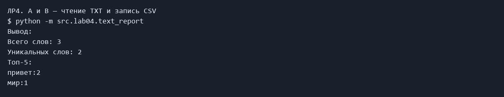

# ЛР4 — TXT, CSV и отчёт

Закрепление чтения и записи файлов с явной кодировкой и автоматизация отчёта по частотам слов в CSV.

### A и B — чтение TXT и запись CSV

```powershell
python -m src.lab04.text_report
```

Фактический вывод:

```text
Всего слов: 3
Уникальных слов: 2
Топ-5:
привет:2
мир:1
```



## Код

### src/lab04/io_txt_csv.py

```python
import csv
from pathlib import Path


def read_text(path: str | Path, encoding: str = "utf-8") -> str:
    """Читает целиком; другую кодировку задают encoding='cp1251'.

    FileNotFoundError и UnicodeDecodeError не перехватываются.
    """
    return Path(path).read_text(encoding=encoding)


def write_csv(
    rows: list[tuple | list], path: str | Path, header: tuple[str, ...] | None = None
) -> None:
    """Пишет CSV. Неодинаковая длина строк — ValueError."""
    width = len(header) if header is not None else None
    for row in rows:
        if width is None:
            width = len(row)
        if len(row) != width:
            raise ValueError("Строки CSV должны иметь одинаковую длину")
    with open(path, "w", encoding="utf-8", newline="") as file:
        writer = csv.writer(file)
        if header is not None:
            writer.writerow(header)
        writer.writerows(rows)

```

### src/lab04/text_report.py

```python
import argparse
from src.lab04.io_txt_csv import read_text, write_csv
from src.lib.text import normalize, tokenize, count_freq, top_n


def main():
    parser = argparse.ArgumentParser(description="Частоты слов в одном файле")
    parser.add_argument("--in", dest="input", default="data/lab04/input.txt")
    parser.add_argument("--out", default="data/lab04/report.csv")
    parser.add_argument("--encoding", default="utf-8")
    args = parser.parse_args()
    tokens = tokenize(normalize(read_text(args.input, args.encoding)))
    freq = count_freq(tokens)
    write_csv(top_n(freq, len(freq)), args.out, ("word", "count"))
    print(f"Всего слов: {len(tokens)}")
    print(f"Уникальных слов: {len(freq)}")
    print("Топ-5:")
    for word, count in top_n(freq):
        print(f"{word}:{count}")


if __name__ == "__main__":
    main()

```

## Вывод

Проверка в файле input.txt даёт report.csv и верное резюме. Пустой файл даёт CSV только с заголовком, файл в cp1251.txt читается через -encoding cp1251, отсутствующий файл вызывает понятный FileNotFoundError.
