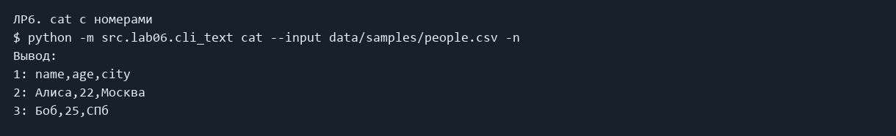
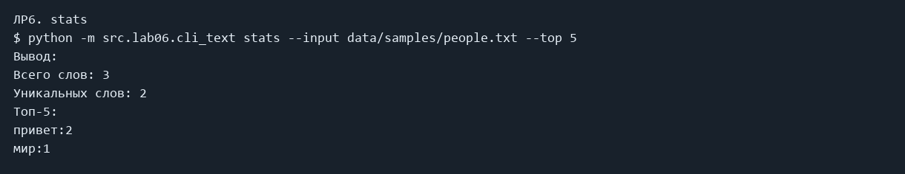
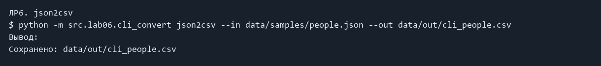

# ЛР6 — Консольные утилиты argparse

Работа над консольными утилитами с подкомандами и флагами.

### cat с номерами

```powershell
python -m src.lab06.cli_text cat --input data/samples/people.csv -n
```

Фактический вывод:

```text
1: name,age,city
2: Алиса,22,Москва
3: Боб,25,СПб
```



### stats

```powershell
python -m src.lab06.cli_text stats --input data/samples/people.txt --top 5
```

Фактический вывод:

```text
Всего слов: 3
Уникальных слов: 2
Топ-5:
привет:2
мир:1
```



### json2csv

```powershell
python -m src.lab06.cli_convert json2csv --in data/samples/people.json --out data/out/cli_people.csv
```

Фактический вывод:

```text
Сохранено: data/out/cli_people.csv
```



### csv2json

```powershell
python -m src.lab06.cli_convert csv2json --in data/samples/people.csv --out data/out/cli_people.json
```

Фактический вывод:

```text
Сохранено: data/out/cli_people.json
```


### csv2xlsx

```powershell
python -m src.lab06.cli_convert csv2xlsx --in data/samples/people.csv --out data/out/cli_people.xlsx
```

Фактический вывод:

```text
Сохранено: data/out/cli_people.xlsx
```


## Справка

```powershell
python -m src.lab06.cli_text --help
```

```text
usage: python.exe -m src.lab06.cli_text [-h] {cat,stats} ...

Вывод текста и статистика

positional arguments:
  {cat,stats}
    cat        Вывести файл
    stats      Частоты слов

options:
  -h, --help   show this help message and exit
```

```powershell
python -m src.lab06.cli_text cat --help
```

```text
usage: python.exe -m src.lab06.cli_text cat [-h] --input INPUT [-n]

options:
  -h, --help     show this help message and exit
  --input INPUT  Путь к файлу UTF-8
  -n             Номера строк
```

```powershell
python -m src.lab06.cli_text stats --help
```

```text
usage: python.exe -m src.lab06.cli_text stats [-h] --input INPUT [--top TOP]

options:
  -h, --help     show this help message and exit
  --input INPUT  Путь к файлу UTF-8
  --top TOP      Количество слов
```

```powershell
python -m src.lab06.cli_convert --help
```

```text
usage: python.exe -m src.lab06.cli_convert [-h]
                                           {json2csv,csv2json,csv2xlsx} ...

Конвертер JSON/CSV/XLSX

positional arguments:
  {json2csv,csv2json,csv2xlsx}
    json2csv            json2csv
    csv2json            csv2json
    csv2xlsx            csv2xlsx

options:
  -h, --help            show this help message and exit
```

```powershell
python -m src.lab06.cli_convert json2csv --help
```

```text
usage: python.exe -m src.lab06.cli_convert json2csv [-h] --in INPUT --out OUT

options:
  -h, --help  show this help message and exit
  --in INPUT  Входной файл
  --out OUT   Выходной файл
```

```powershell
python -m src.lab06.cli_convert csv2json --help
```

```text
usage: python.exe -m src.lab06.cli_convert csv2json [-h] --in INPUT --out OUT

options:
  -h, --help  show this help message and exit
  --in INPUT  Входной файл
  --out OUT   Выходной файл
```

```powershell
python -m src.lab06.cli_convert csv2xlsx --help
```

```text
usage: python.exe -m src.lab06.cli_convert csv2xlsx [-h] --in INPUT --out OUT

options:
  -h, --help  show this help message and exit
  --in INPUT  Входной файл
  --out OUT   Выходной файл
```

## Код

### src/lab06/cli_convert.py

```python
import argparse
from src.lab05.json_csv import json_to_csv, csv_to_json
from src.lab05.csv_xlsx import csv_to_xlsx


def main():
    parser = argparse.ArgumentParser(description="Конвертер JSON/CSV/XLSX")
    commands = parser.add_subparsers(dest="command", required=True)
    for name in ("json2csv", "csv2json", "csv2xlsx"):
        command = commands.add_parser(name, help=name)
        command.add_argument("--in", dest="input", required=True, help="Входной файл")
        command.add_argument("--out", required=True, help="Выходной файл")
    args = parser.parse_args()
    if args.command == "json2csv":
        json_to_csv(args.input, args.out)
    elif args.command == "csv2json":
        csv_to_json(args.input, args.out)
    else:
        csv_to_xlsx(args.input, args.out)
    print(f"Сохранено: {args.out}")


if __name__ == "__main__":
    main()

```

### src/lab06/cli_text.py

```python
import argparse
from src.lab04.io_txt_csv import read_text
from src.lib.text import normalize, tokenize, count_freq, top_n


def main():
    parser = argparse.ArgumentParser(description="Вывод текста и статистика")
    commands = parser.add_subparsers(dest="command", required=True)
    cat = commands.add_parser("cat", help="Вывести файл")
    cat.add_argument("--input", required=True, help="Путь к файлу UTF-8")
    cat.add_argument("-n", action="store_true", help="Номера строк")
    stats = commands.add_parser("stats", help="Частоты слов")
    stats.add_argument("--input", required=True, help="Путь к файлу UTF-8")
    stats.add_argument("--top", type=int, default=5, help="Количество слов")
    args = parser.parse_args()
    if args.command == "stats" and args.top < 0:
        parser.error("--top должен быть неотрицательным")
    text = read_text(args.input)
    if args.command == "cat":
        for number, line in enumerate(text.splitlines(), 1):
            if args.n:
                print(f"{number}: {line}")
            else:
                print(line)
    else:
        tokens = tokenize(normalize(text))
        freq = count_freq(tokens)
        print(f"Всего слов: {len(tokens)}")
        print(f"Уникальных слов: {len(freq)}")
        print(f"Топ-{args.top}:")
        for word, count in top_n(freq, args.top):
            print(f"{word}:{count}")


if __name__ == "__main__":
    main()

```

## Вывод

Обязательные задания выполнены. Задания со звёздочками пропущены. Изображения выше сформированы из сохранённого фактического stdout/stderr; это не снимки окна терминала.
