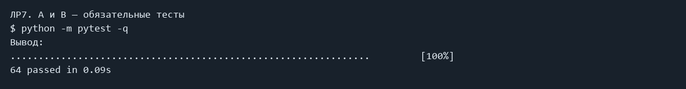
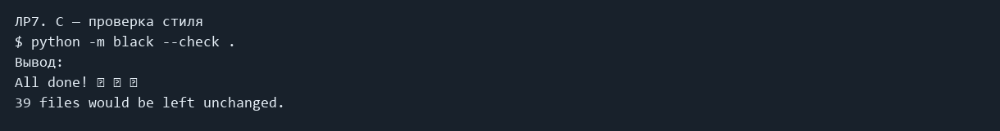

# ЛР7 — Тестирование и стиль

## Задание и решение

Автотест сравнивает результат с ожидаемым через assert. pytest.mark.parametrize запускает одну проверку на разных данных. tmp_path создаёт временную папку, pytest.raises проверяет исключение. Тесты для текста и конвертеров находятся в tests/test_text.py и tests/test_json_csv.py. Дополнительно там перенесены обязательные тест-кейсы ЛР2 и ЛР4. black приводит код к единому стилю. Задание на покрытие со звёздочкой не выполнено.

## Запуск

Все команды выполняются из корня папки `python_labs`, после установки `requirements.txt`.

### A и B — обязательные тесты

```powershell
python -m pytest -q
```

Фактический вывод:

```text
................................................................         [100%]
64 passed in 0.09s
```



### C — проверка стиля

```powershell
python -m black --check .
```

Фактический вывод:

```text
All done! ✨ 🍰 ✨
39 files would be left unchanged.
```



## Код

### tests/test_json_csv.py

```python
import csv
import json
import pytest
from src.lab05.json_csv import json_to_csv, csv_to_json


def test_json_to_csv(tmp_path):
    source = tmp_path / "people.json"
    result = tmp_path / "people.csv"
    source.write_text(
        '[{"name": "Алиса", "age": 22}, {"name": "Боб", "age": 25}]', encoding="utf-8"
    )
    json_to_csv(source, result)
    with result.open(encoding="utf-8", newline="") as file:
        reader = csv.DictReader(file)
        assert reader.fieldnames == ["name", "age"]
        rows = list(reader)
    assert rows == [{"name": "Алиса", "age": "22"}, {"name": "Боб", "age": "25"}]


def test_csv_to_json(tmp_path):
    source = tmp_path / "people.csv"
    result = tmp_path / "people.json"
    source.write_text("name,age\nАлиса,22\nБоб,25\n", encoding="utf-8")
    csv_to_json(source, result)
    data = json.loads(result.read_text(encoding="utf-8"))
    assert data == [{"name": "Алиса", "age": "22"}, {"name": "Боб", "age": "25"}]


def test_missing_fields(tmp_path):
    source = tmp_path / "people.json"
    result = tmp_path / "people.csv"
    source.write_text('[{"name": "Алиса"}, {"age": 25}]', encoding="utf-8")
    json_to_csv(source, result)
    with result.open(encoding="utf-8", newline="") as file:
        assert list(csv.DictReader(file)) == [
            {"name": "Алиса", "age": ""},
            {"name": "", "age": "25"},
        ]


@pytest.mark.parametrize("content", ["", "{", "[]", "{}", '["text"]'])
def test_bad_json(tmp_path, content):
    source = tmp_path / "bad.json"
    source.write_text(content, encoding="utf-8")
    with pytest.raises(ValueError):
        json_to_csv(source, tmp_path / "result.csv")


@pytest.mark.parametrize(
    "content", ["", "\n", "name,name\nA,B", "name,age\nA,22,extra", ",age\nA,22"]
)
def test_bad_csv(tmp_path, content):
    source = tmp_path / "bad.csv"
    source.write_text(content, encoding="utf-8")
    with pytest.raises(ValueError):
        csv_to_json(source, tmp_path / "result.json")


def test_missing_files(tmp_path):
    with pytest.raises(FileNotFoundError):
        json_to_csv(tmp_path / "missing.json", tmp_path / "result.csv")
    with pytest.raises(FileNotFoundError):
        csv_to_json(tmp_path / "missing.csv", tmp_path / "result.json")

```

### tests/test_lab02.py

```python
import pytest
from src.lab02.arrays import min_max, unique_sorted, flatten
from src.lab02.matrix import transpose, row_sums, col_sums
from src.lab02.tuples import format_record


@pytest.mark.parametrize(
    "nums, expected",
    [
        ([3, -1, 5, 5, 0], (-1, 5)),
        ([42], (42, 42)),
        ([-5, -2, -9], (-9, -2)),
        ([1.5, 2, 2.0, -3.1], (-3.1, 2)),
    ],
)
def test_min_max(nums, expected):
    assert min_max(nums) == expected


def test_min_max_empty():
    with pytest.raises(ValueError):
        min_max([])


@pytest.mark.parametrize(
    "nums, expected",
    [
        ([3, 1, 2, 1, 3], [1, 2, 3]),
        ([], []),
        ([-1, -1, 0, 2, 2], [-1, 0, 2]),
        ([1.0, 1, 2.5, 2.5, 0], [0, 1.0, 2.5]),
    ],
)
def test_unique_sorted(nums, expected):
    assert unique_sorted(nums) == expected


@pytest.mark.parametrize(
    "mat, expected",
    [
        ([[1, 2], [3, 4]], [1, 2, 3, 4]),
        ([[1, 2], (3, 4, 5)], [1, 2, 3, 4, 5]),
        ([[1], [], [2, 3]], [1, 2, 3]),
    ],
)
def test_flatten(mat, expected):
    assert flatten(mat) == expected


def test_flatten_bad_row():
    with pytest.raises(TypeError):
        flatten([[1, 2], "ab"])


@pytest.mark.parametrize(
    "mat, expected",
    [
        ([[1, 2, 3]], [[1], [2], [3]]),
        ([[1], [2], [3]], [[1, 2, 3]]),
        ([[1, 2], [3, 4]], [[1, 3], [2, 4]]),
        ([], []),
    ],
)
def test_transpose(mat, expected):
    assert transpose(mat) == expected


@pytest.mark.parametrize(
    "mat, rows, cols",
    [
        ([[1, 2, 3], [4, 5, 6]], [6, 15], [5, 7, 9]),
        ([[-1, 1], [10, -10]], [0, 0], [9, -9]),
        ([[0, 0], [0, 0]], [0, 0], [0, 0]),
    ],
)
def test_sums(mat, rows, cols):
    assert row_sums(mat) == rows
    assert col_sums(mat) == cols


@pytest.mark.parametrize("function", [transpose, row_sums, col_sums])
def test_ragged(function):
    with pytest.raises(ValueError):
        function([[1, 2], [3]])


@pytest.mark.parametrize(
    "record, expected",
    [
        (
            ("Иванов Иван Иванович", "BIVT-25", 4.6),
            "Иванов И.И., гр. BIVT-25, GPA 4.60",
        ),
        (("Петров Пётр", "IKBO-12", 5.0), "Петров П., гр. IKBO-12, GPA 5.00"),
        (
            ("Петров Пётр Петрович", "IKBO-12", 5.0),
            "Петров П.П., гр. IKBO-12, GPA 5.00",
        ),
        (
            ("  сидорова  анна   сергеевна ", "ABB-01", 3.999),
            "Сидорова А.С., гр. ABB-01, GPA 4.00",
        ),
    ],
)
def test_record(record, expected):
    assert format_record(record) == expected


@pytest.mark.parametrize(
    "record",
    [
        ("", "A", 4),
        ("Иванов Иван", "", 4),
        ("Иванов Иван", "A", "4"),
        ("Иванов Иван", "A", 6),
    ],
)
def test_bad_record(record):
    with pytest.raises((ValueError, TypeError)):
        format_record(record)

```

### tests/test_lab04.py

```python
import pytest
from src.lab04.io_txt_csv import read_text, write_csv


def test_read_and_write(tmp_path):
    source = tmp_path / "input.txt"
    source.write_text("Привет", encoding="utf-8")
    assert read_text(source) == "Привет"
    result = tmp_path / "report.csv"
    write_csv([("привет", 1)], result, ("word", "count"))
    assert result.read_text(encoding="utf-8").splitlines() == ["word,count", "привет,1"]


def test_empty(tmp_path):
    source = tmp_path / "empty.txt"
    source.write_text("", encoding="utf-8")
    assert read_text(source) == ""
    result = tmp_path / "empty.csv"
    write_csv([], result, ("word", "count"))
    assert result.read_text(encoding="utf-8").strip() == "word,count"
    write_csv([], result)
    assert result.read_text(encoding="utf-8") == ""


def test_cp1251(tmp_path):
    source = tmp_path / "input.txt"
    source.write_text("Привет", encoding="cp1251")
    assert read_text(source, "cp1251") == "Привет"


def test_different_lengths(tmp_path):
    with pytest.raises(ValueError):
        write_csv([("a", 1), ("b",)], tmp_path / "bad.csv")

```

### tests/test_text.py

```python
import pytest
from src.lib.text import normalize, tokenize, count_freq, top_n


@pytest.mark.parametrize(
    "source, expected",
    [
        ("ПрИвЕт\nМИр\t", "привет мир"),
        ("ёжик, Ёлка", "ежик, елка"),
        ("Hello\r\nWorld", "hello world"),
        ("  двойные   пробелы  ", "двойные пробелы"),
        ("", ""),
    ],
)
def test_normalize(source, expected):
    assert normalize(source) == expected


def test_normalize_options():
    assert normalize("ЁЖИК", yo2e=False) == "ёжик"
    assert normalize("Straße", casefold=False) == "straße"
    assert normalize("Straße") == "strasse"


@pytest.mark.parametrize(
    "source, expected",
    [
        ("привет мир", ["привет", "мир"]),
        ("hello,world!!!", ["hello", "world"]),
        ("по-настоящему круто", ["по-настоящему", "круто"]),
        ("2025 год", ["2025", "год"]),
        ("emoji 😀 не слово", ["emoji", "не", "слово"]),
        ("", []),
    ],
)
def test_tokenize(source, expected):
    assert tokenize(source) == expected


def test_count_freq():
    assert count_freq(["a", "b", "a", "c", "b", "a"]) == {"a": 3, "b": 2, "c": 1}
    assert count_freq([]) == {}


def test_top_n():
    freq = count_freq(["a", "b", "a", "c", "b", "a"])
    assert top_n(freq, 2) == [("a", 3), ("b", 2)]
    assert top_n(freq, 0) == []
    assert top_n({}, 5) == []


def test_top_n_tie():
    freq = count_freq(["bb", "aa", "bb", "aa", "cc"])
    assert top_n(freq, 2) == [("aa", 2), ("bb", 2)]

```

## Вывод

Обязательные задания выполнены. Задания со звёздочками пропущены. Изображения выше сформированы из сохранённого фактического stdout/stderr; это не снимки окна терминала.
