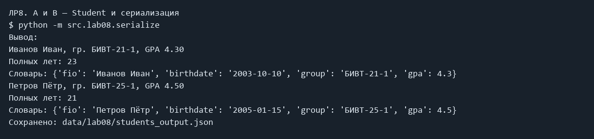

# ЛР8 — Класс Student и JSON

## Задание и решение

Класс описывает данные и поведение; объект — экземпляр класса. @dataclass создаёт __init__, __repr__, __eq__. __post_init__ проверяет ФИО, группу, дату YYYY-MM-DD и GPA 0–5. age учитывает, прошёл ли день рождения; число лет зависит от даты запуска. to_dict и from_dict переводят объект в словарь и обратно. serialize сохраняет и читает массив JSON. Входной и выходной JSON имеют одинаковые данные. Ошибки шаблонного кода из задания исправлены.

## Запуск

Все команды выполняются из корня папки `python_labs`, после установки `requirements.txt`.

### A и B — Student и сериализация

```powershell
python -m src.lab08.serialize
```

Фактический вывод:

```text
Иванов Иван, гр. БИВТ-21-1, GPA 4.30
Полных лет: 23
Словарь: {'fio': 'Иванов Иван', 'birthdate': '2003-10-10', 'group': 'БИВТ-21-1', 'gpa': 4.3}
Петров Пётр, гр. БИВТ-25-1, GPA 4.50
Полных лет: 21
Словарь: {'fio': 'Петров Пётр', 'birthdate': '2005-01-15', 'group': 'БИВТ-25-1', 'gpa': 4.5}
Сохранено: data/lab08/students_output.json
```



## students_input.json

```json
[
  {"fio": "Иванов Иван", "birthdate": "2003-10-10", "group": "БИВТ-21-1", "gpa": 4.3},
  {"fio": "Петров Пётр", "birthdate": "2005-01-15", "group": "БИВТ-25-1", "gpa": 4.5}
]

```

## students_output.json

```json
[
  {
    "fio": "Иванов Иван",
    "birthdate": "2003-10-10",
    "group": "БИВТ-21-1",
    "gpa": 4.3
  },
  {
    "fio": "Петров Пётр",
    "birthdate": "2005-01-15",
    "group": "БИВТ-25-1",
    "gpa": 4.5
  }
]
```

## Код

### src/lab08/models.py

```python
from dataclasses import dataclass
from datetime import date


@dataclass
class Student:
    """Студент: ФИО, дата рождения, группа и средний балл 0–5."""

    fio: str
    birthdate: str
    group: str
    gpa: float

    def __post_init__(self):
        if not isinstance(self.fio, str) or not self.fio.strip():
            raise ValueError("ФИО должно быть непустой строкой")
        if not isinstance(self.group, str) or not self.group.strip():
            raise ValueError("Группа должна быть непустой строкой")
        if not isinstance(self.birthdate, str):
            raise ValueError("Дата должна быть строкой YYYY-MM-DD")
        birthday = date.fromisoformat(self.birthdate)
        if birthday.isoformat() != self.birthdate or birthday > date.today():
            raise ValueError("Нужна дата YYYY-MM-DD, не позже сегодняшней")
        if isinstance(self.gpa, bool) or not isinstance(self.gpa, (int, float)):
            raise ValueError("Средний балл должен быть числом")
        if not 0 <= self.gpa <= 5:
            raise ValueError("Средний балл должен быть от 0 до 5")

    def age(self) -> int:
        """Возвращает полные годы с учётом дня рождения."""
        birthday = date.fromisoformat(self.birthdate)
        today = date.today()
        years = today.year - birthday.year
        if (today.month, today.day) < (birthday.month, birthday.day):
            years -= 1
        return years

    def to_dict(self) -> dict:
        """Возвращает четыре поля в словаре."""
        return {
            "fio": self.fio,
            "birthdate": self.birthdate,
            "group": self.group,
            "gpa": self.gpa,
        }

    @classmethod
    def from_dict(cls, data: dict):
        """Создаёт студента из словаря с проверкой полей."""
        if not isinstance(data, dict) or set(data) != {
            "fio",
            "birthdate",
            "group",
            "gpa",
        }:
            raise ValueError("Нужны поля fio, birthdate, group, gpa")
        return cls(data["fio"], data["birthdate"], data["group"], data["gpa"])

    def __str__(self) -> str:
        return f"{self.fio}, гр. {self.group}, GPA {self.gpa:.2f}"

```

### src/lab08/serialize.py

```python
import json
from src.lab08.models import Student


def students_to_json(students: list[Student], path: str) -> None:
    """Сохраняет студентов как JSON-массив."""
    data = []
    for student in students:
        if not isinstance(student, Student):
            raise ValueError("Нужен список студентов")
        student.__post_init__()
        data.append(student.to_dict())
    with open(path, "w", encoding="utf-8") as file:
        json.dump(data, file, ensure_ascii=False, indent=2)


def students_from_json(path: str) -> list[Student]:
    """Читает массив и создаёт проверенные объекты Student."""
    with open(path, encoding="utf-8") as file:
        data = json.load(file)
    if not isinstance(data, list):
        raise ValueError("JSON должен содержать список")
    students = []
    for record in data:
        students.append(Student.from_dict(record))
    return students


if __name__ == "__main__":
    students = students_from_json("data/lab08/students_input.json")
    for student in students:
        print(student)
        print("Полных лет:", student.age())
        print("Словарь:", student.to_dict())
    students_to_json(students, "data/lab08/students_output.json")
    print("Сохранено: data/lab08/students_output.json")

```

## Вывод

Обязательные задания выполнены. Задания со звёздочками пропущены. Изображения выше сформированы из сохранённого фактического stdout/stderr; это не снимки окна терминала.
