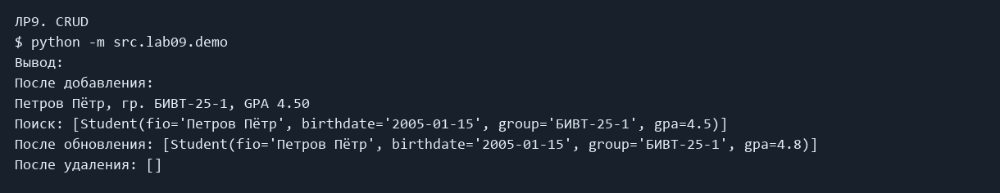

# ЛР9 — CSV-хранилище Group

## Задание и решение

CRUD: Create — add, Read — list/find, Update — update, Delete — remove. Group хранит путь к CSV, проверяет заголовок и каждую запись через Student. Каждая операция читает весь файл: это просто, но подходит для небольших данных. find не учитывает регистр (ё и е остаются разными символами). Повторяющиеся ФИО разрешены; update и remove действуют на все точные совпадения. update для отсутствующего ФИО вызывает ValueError. remove отсутствующего ФИО ничего не меняет. Демонстрация использует отдельный файл demo_students.csv. Аналитика со звёздочкой не реализована.

## Запуск

Все команды выполняются из корня папки `python_labs`, после установки `requirements.txt`.

### CRUD

```powershell
python -m src.lab09.demo
```

Фактический вывод:

```text
После добавления:
Петров Пётр, гр. БИВТ-25-1, GPA 4.50
Поиск: [Student(fio='Петров Пётр', birthdate='2005-01-15', group='БИВТ-25-1', gpa=4.5)]
После обновления: [Student(fio='Петров Пётр', birthdate='2005-01-15', group='БИВТ-25-1', gpa=4.8)]
После удаления: []
```



## Код

### src/lab09/demo.py

```python
from src.lab08.models import Student
from src.lab09.group import Group


def main():
    # Отдельный файл демонстрации; исходная база students.csv не меняется.
    group = Group("data/lab09/demo_students.csv")
    group.remove("Петров Пётр")
    group.add(Student("Петров Пётр", "2005-01-15", "БИВТ-25-1", 4.5))
    print("После добавления:")
    for student in group.list():
        print(student)
    print("Поиск:", group.find("петр"))
    group.update("Петров Пётр", gpa=4.8)
    print("После обновления:", group.list())
    group.remove("Петров Пётр")
    print("После удаления:", group.list())


if __name__ == "__main__":
    main()

```

### src/lab09/group.py

```python
import csv
from pathlib import Path
from src.lab08.models import Student


class Group:
    """Простое CSV-хранилище студентов. Каждая операция читает весь файл."""

    def __init__(self, storage_path: str):
        self.path = Path(storage_path)
        self.header = ["fio", "birthdate", "group", "gpa"]
        self.path.parent.mkdir(parents=True, exist_ok=True)
        if not self.path.exists():
            self._write_all([])
        self.list()

    def list(self) -> list[Student]:
        """Читает и проверяет все записи."""
        students = []
        with self.path.open(encoding="utf-8", newline="") as file:
            reader = csv.DictReader(file)
            if reader.fieldnames != self.header:
                raise ValueError("Неверный заголовок CSV")
            for row in reader:
                if None in row or any(value is None for value in row.values()):
                    raise ValueError("Неверное число полей CSV")
                row["gpa"] = float(row["gpa"])
                students.append(Student.from_dict(row))
        return students

    def _write_all(self, students):
        """Перезаписывает файл заголовком и записями."""
        for student in students:
            student.__post_init__()
        with self.path.open("w", encoding="utf-8", newline="") as file:
            writer = csv.DictWriter(file, fieldnames=self.header)
            writer.writeheader()
            for student in students:
                writer.writerow(student.to_dict())

    def add(self, student: Student) -> None:
        """Добавляет студента. Совпадающие ФИО разрешены."""
        if not isinstance(student, Student):
            raise TypeError("Нужен объект Student")
        students = self.list()
        students.append(student)
        self._write_all(students)

    def find(self, substr: str) -> list[Student]:
        """Ищет подстроку ФИО без учёта регистра."""
        result = []
        for student in self.list():
            if substr.casefold() in student.fio.casefold():
                result.append(student)
        return result

    def remove(self, fio: str) -> None:
        """Удаляет все точные совпадения ФИО. Отсутствие — без ошибки."""
        result = []
        for student in self.list():
            if student.fio != fio:
                result.append(student)
        self._write_all(result)

    def update(self, fio: str, **fields) -> None:
        """Обновляет все совпадения. Если ФИО не найдено — ValueError."""
        if not set(fields).issubset(self.header):
            raise ValueError("Неизвестное поле студента")
        students = self.list()
        found = False
        for i, student in enumerate(students):
            if student.fio == fio:
                data = student.to_dict()
                data.update(fields)
                students[i] = Student.from_dict(data)
                found = True
        if not found:
            raise ValueError("Студент не найден")
        self._write_all(students)

```

## Вывод

Обязательные задания выполнены. Задания со звёздочками пропущены. Изображения выше сформированы из сохранённого фактического stdout/stderr; это не снимки окна терминала.
