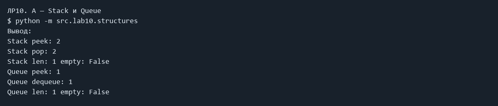
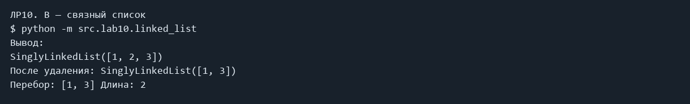
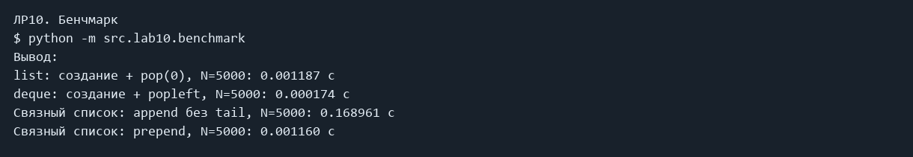

# ЛР10 — Стек, очередь и связный список

Реализация стека, очереди и односвязного списка, сравнение их скорости.

### A — Stack и Queue

```powershell
python -m src.lab10.structures
```

Фактический вывод:

```text
Stack peek: 2
Stack pop: 2
Stack len: 1 empty: False
Queue peek: 1
Queue dequeue: 1
Queue len: 1 empty: False
```



### B — связный список

```powershell
python -m src.lab10.linked_list
```

Фактический вывод:

```text
SinglyLinkedList([1, 2, 3])
После удаления: SinglyLinkedList([1, 3])
Перебор: [1, 3] Длина: 2
```



### Бенчмарк

```powershell
python -m src.lab10.benchmark
```

Фактический вывод:

```text
list: создание + pop(0), N=5000: 0.001187 с
deque: создание + popleft, N=5000: 0.000174 с
Связный список: append без tail, N=5000: 0.168961 с
Связный список: prepend, N=5000: 0.001160 с
```



## Код

### src/lab10/benchmark.py

```python
from collections import deque
from time import perf_counter
from src.lab10.linked_list import SinglyLinkedList


def main():
    n = 5000
    start = perf_counter()
    values = list(range(n))
    while values:
        values.pop(0)
    print(f"list: создание + pop(0), N={n}: {perf_counter() - start:.6f} с")
    start = perf_counter()
    values = deque(range(n))
    while values:
        values.popleft()
    print(f"deque: создание + popleft, N={n}: {perf_counter() - start:.6f} с")
    start = perf_counter()
    values = SinglyLinkedList()
    for i in range(n):
        values.append(i)
    print(f"Связный список: append без tail, N={n}: {perf_counter() - start:.6f} с")
    start = perf_counter()
    values = SinglyLinkedList()
    for i in range(n):
        values.prepend(i)
    print(f"Связный список: prepend, N={n}: {perf_counter() - start:.6f} с")


if __name__ == "__main__":
    main()

```

### src/lab10/linked_list.py

```python
class Node:
    """Узел: значение и ссылка на следующий узел."""

    def __init__(self, value):
        self.value = value
        self.next = None


class SinglyLinkedList:
    """Односвязный список без хвоста; append проходит весь список."""

    def __init__(self):
        self.head = None
        self._size = 0

    def append(self, value) -> None:
        node = Node(value)
        if self.head is None:
            self.head = node
        else:
            current = self.head
            while current.next is not None:
                current = current.next
            current.next = node
        self._size += 1

    def prepend(self, value) -> None:
        node = Node(value)
        node.next = self.head
        self.head = node
        self._size += 1

    def insert(self, idx: int, value) -> None:
        if idx < 0 or idx > self._size:
            raise IndexError("Индекс вне списка")
        if idx == 0:
            self.prepend(value)
            return
        current = self.head
        for i in range(idx - 1):
            current = current.next
        node = Node(value)
        node.next = current.next
        current.next = node
        self._size += 1

    def remove(self, value) -> None:
        """Удаляет первое вхождение. Если значения нет — ValueError."""
        previous = None
        current = self.head
        while current is not None:
            if current.value == value:
                if previous is None:
                    self.head = current.next
                else:
                    previous.next = current.next
                self._size -= 1
                return
            previous = current
            current = current.next
        raise ValueError("Значение не найдено")

    def __iter__(self):
        current = self.head
        while current is not None:
            yield current.value
            current = current.next

    def __len__(self) -> int:
        return self._size

    def __repr__(self) -> str:
        return f"SinglyLinkedList({list(self)})"


if __name__ == "__main__":
    linked = SinglyLinkedList()
    linked.append(2)
    linked.prepend(1)
    linked.insert(2, 3)
    print(linked)
    linked.remove(2)
    print("После удаления:", linked)
    print("Перебор:", list(linked), "Длина:", len(linked))

```

### src/lab10/structures.py

```python
from collections import deque


class Stack:
    """Стек LIFO: последний добавленный элемент выходит первым."""

    def __init__(self):
        self._data = []

    def push(self, item) -> None:
        self._data.append(item)

    def pop(self):
        if self.is_empty():
            raise IndexError("Стек пуст")
        return self._data.pop()

    def peek(self):
        if self.is_empty():
            return None
        return self._data[-1]

    def is_empty(self) -> bool:
        return len(self._data) == 0

    def __len__(self) -> int:
        return len(self._data)


class Queue:
    """Очередь FIFO: первый добавленный элемент выходит первым."""

    def __init__(self):
        self._data = deque()

    def enqueue(self, item) -> None:
        self._data.append(item)

    def dequeue(self):
        if self.is_empty():
            raise IndexError("Очередь пуста")
        return self._data.popleft()

    def peek(self):
        if self.is_empty():
            return None
        return self._data[0]

    def is_empty(self) -> bool:
        return len(self._data) == 0

    def __len__(self) -> int:
        return len(self._data)


if __name__ == "__main__":
    stack = Stack()
    stack.push(1)
    stack.push(2)
    print("Stack peek:", stack.peek())
    print("Stack pop:", stack.pop())
    print("Stack len:", len(stack), "empty:", stack.is_empty())
    queue = Queue()
    queue.enqueue(1)
    queue.enqueue(2)
    print("Queue peek:", queue.peek())
    print("Queue dequeue:", queue.dequeue())
    print("Queue len:", len(queue), "empty:", queue.is_empty())

```

## Вывод

Все классы ведут себя как описано, ошибки на пустых структурах корректны. В бенчмарке при N = 5000 deque (около 0,0002 с) заметно быстрее list.pop(0) (около 0,001 с), а append без tail (около 0,17–0,23 с) на два порядка медленнее prepend (около 0,001 с) — потому что каждый append проходит весь список. 
